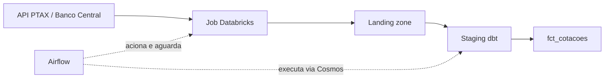

# Pipeline PTAX — Databricks, dbt e Airflow

Projeto de engenharia de dados para organizar cotações de moedas provenientes da API PTAX do Banco Central do Brasil. O Airflow aciona a ingestão no Databricks e, após sua conclusão, executa as transformações e os testes do dbt com Astronomer Cosmos.

O resultado é uma tabela analítica com uma cotação de compra por moeda e dia, incluindo dias sem publicação, preenchidos com a última cotação disponível.

## Arquitetura




1. A DAG `ptax_dbt_pipeline` dispara um Job existente no Databricks.
2. O Job deve consultar a API e disponibilizar as tabelas de origem.
3. O Airflow aguarda o término da ingestão antes de liberar o grupo `dbt_models`.
4. O Cosmos usa o manifesto dbt para montar as tarefas de transformação e os testes associados aos modelos.
5. Os modelos gravam tabelas Delta de staging e marts no Databricks.

**Escopo:** estão versionados a orquestração, os modelos, as macros, os testes declarativos e a configuração da imagem local. O código de extração da API, os notebooks e a criação do Job Databricks não estão neste repositório. Esses recursos precisam existir no workspace para executar o fluxo completo.

## Tecnologias

| Componente | Responsabilidade |
| --- | --- |
| Airflow / Astro Runtime | Orquestração e ambiente local em contêineres |
| Databricks | Ingestão externa e processamento SQL dos modelos |
| Delta Lake | Formato das tabelas tratadas |
| dbt Core / dbt-databricks | Modelagem SQL, dependências, documentação e testes |
| Astronomer Cosmos | Integração dos modelos dbt ao grafo do Airflow |
| Databricks provider | Disparo e acompanhamento do Job pelo Airflow |

O `Dockerfile` usa `astrocrpublic.azurecr.io/runtime:3.3-11` e instala o dbt em um ambiente virtual separado: `/usr/local/airflow/dbt_venv`. As versões declaradas são `dbt-core==1.12.5` e `dbt-databricks==1.12.7`. Cosmos e o provider Databricks estão em `requirements.txt`, sem versões fixadas.

## Estrutura do repositório

```text
.
├── dags/
│   ├── dag_ptax_pipeline.py       # Pipeline PTAX
│   └── exampledag.py              # Exemplo Astro independente do PTAX
├── db_dbt_airflow/
│   ├── dbt_project.yml           # Materializações, schemas e caminhos
│   ├── profiles.yml              # Perfil Databricks via OAuth
│   ├── macros/
│   │   ├── audit_columns.sql     # Metadados de execução
│   │   └── surrogate_key.sql     # Chave determinística por MD5
│   ├── models/
│   │   ├── staging/              # Origens, padronização e testes
│   │   └── marts/                # Tabela analítica
│   ├── analyses/
│   ├── seeds/
│   ├── snapshots/
│   └── tests/
├── tests/dags/test_dag_example.py # Testes genéricos do template Astro
├── Dockerfile
├── requirements.txt              # Dependências do Airflow
├── dbt-requirements.txt          # Dependências do ambiente dbt
└── packages.txt                  # Dependências adicionais de sistema (vazio)
```

As pastas `analyses`, `seeds`, `snapshots` e `db_dbt_airflow/tests` contêm apenas arquivos de controle de diretório. Os testes de dados existentes são declarados nos YAMLs de staging.

## Modelagem e regras de negócio

### Landing zone

As origens são declaradas em `db_dbt_airflow/models/staging/sources.yml`:

| Tabela | Colunas consumidas |
| --- | --- |
| `databricks_dbt_airflow.db_dbt_airflow.src_moedas` | `NomeMoeda`, `Moeda` |
| `databricks_dbt_airflow.db_dbt_airflow.src_cotacoes` | `cotacaoCompra`, `dataHoraCotacao`, `moeda` |

O catálogo e o schema de leitura são fixos nesse arquivo. Alterar as variáveis do perfil dbt não altera essas referências; para outra landing zone, ajuste também `sources.yml`.

### Staging

Os modelos usam materialização incremental, estratégia `merge` e formato Delta.

| Modelo | Transformações | Chave do merge |
| --- | --- | --- |
| `stg_moedas` | Remove espaços nas extremidades e converte nome e código para maiúsculas | `moeda` |
| `stg_cotacoes` | Padroniza o código, converte a compra para `DECIMAL(18,6)` e a data/hora para `TIMESTAMP` | `moeda`, `data_hora_cotacao` |

Não há filtro com `is_incremental()`: cada execução lê toda a origem e faz o merge pelas chaves configuradas. A configuração de `unique_key` não elimina duplicidades na entrada.

### Marts

`fct_cotacoes` é recriada como tabela Delta em cada execução e depende de `stg_cotacoes`. O modelo:

1. Identifica a primeira data disponível por moeda.
2. Gera um calendário diário até `CURRENT_DATE()`.
3. Seleciona a cotação com o horário mais recente por moeda e dia.
4. Preenche datas sem cotação com o último valor não nulo anterior, incluindo fins de semana e feriados.
5. Acrescenta chave e metadados de auditoria.

A seleção diária usa o maior `data_hora_cotacao`, sem filtro explícito por tipo de boletim. Somente a cotação de **compra** é utilizada.

| Coluna final | Descrição |
| --- | --- |
| `cotacao_id` | MD5 de moeda e data, gerado pela macro `generate_surrogate_key` |
| `moeda` | Código padronizado |
| `data` | Dia do calendário |
| `cotacao` | Última cotação de compra disponível para o dia |
| `dbt_load_at` | Timestamp da transformação |
| `dbt_run_id` | `invocation_id` da execução dbt |

O grão esperado é uma linha por moeda e data. Os metadados de auditoria são atualizados a cada reconstrução da tabela.

### Schemas de destino

O perfil define o catálogo por `DATABRICKS_CATALOG` e o schema base por `DATABRICKS_SCHEMA`. O projeto configura schemas personalizados `stg` e `marts`. Sem uma macro própria de `generate_schema_name`, o padrão do dbt gera `<schema_base>_stg` e `<schema_base>_marts`.

## Configuração local

### Pré-requisitos

- Docker e Astro CLI disponíveis na máquina.
- Workspace Databricks com um Job que produza as tabelas de origem.
- Endpoint SQL compatível com o adapter dbt e seu HTTP Path.
- Service principal OAuth com acesso ao endpoint, leitura das origens e criação/atualização dos objetos de destino.
- Credenciais para a conexão Airflow executar o Job Databricks.

### 1. Variáveis de ambiente

Crie `.env` na raiz com os valores do seu ambiente:

```dotenv
DATABRICKS_HOST=seu-workspace.cloud.databricks.com
DATABRICKS_HTTP_PATH=/sql/1.0/warehouses/seu-warehouse-id
DATABRICKS_CATALOG=databricks_dbt_airflow
DATABRICKS_SCHEMA=db_dbt_airflow
DATABRICKS_CLIENT_ID=seu-client-id
DATABRICKS_CLIENT_SECRET=seu-client-secret
```

`profiles.yml` usa essas seis variáveis no target `dev`, com `auth_type: oauth` e quatro threads. Disponibilize-as aos contêineres pelo ambiente local do Astro. Para executar dbt no host, exporte-as também no terminal: o dbt não carrega `.env` automaticamente.

O `.env` é ignorado pelo Git e excluído do contexto Docker. Mantenha credenciais fora dos arquivos versionados.

### 2. Job e conexão Airflow

Ajuste `DATABRICKS_JOB_ID` em `dags/dag_ptax_pipeline.py` para o Job do seu workspace. O valor atualmente configurado é `479652614826982`.

Na interface do Airflow, crie a conexão `databricks_default`, do tipo Databricks, com o host e a autenticação apropriada. Essa conexão atende à ingestão; o dbt utiliza separadamente as variáveis OAuth do perfil.

### 3. Manifesto dbt

A DAG usa `LoadMode.DBT_MANIFEST` e exige este arquivo no contêiner:

```text
/usr/local/airflow/db_dbt_airflow/target/manifest.json
```

`target/` não é versionado e o `Dockerfile` não gera o manifesto. Antes de carregar a DAG, gere-o no projeto local. Uma opção é instalar o dbt em um ambiente virtual no host, fora do repositório:

```bash
python -m venv /tmp/ptax-dbt-venv
source /tmp/ptax-dbt-venv/bin/activate
pip install -r dbt-requirements.txt

dbt parse --project-dir db_dbt_airflow --profiles-dir db_dbt_airflow --target dev
```

Esses comandos pressupõem que as variáveis do perfil estejam exportadas. O ambiente acima serve à preparação local; a DAG usa o ambiente instalado no contêiner.

Confirme a criação de `db_dbt_airflow/target/manifest.json`. Gere-o novamente ao alterar modelos ou testes e disponibilize a versão atualizada no caminho esperado pelo Airflow. Em uma implantação, inclua a geração e a entrega desse artefato no processo de build/deploy.

### 4. Iniciar e executar

Na raiz do projeto:

```bash
astro dev start
```

Acesse a interface pelo endereço informado pelo Astro, configure a conexão Databricks e dispare manualmente `ptax_dbt_pipeline`. Garanta que o manifesto esteja presente no contêiner; caso tenha sido gerado após a construção da imagem, reconstrua/reinicie o ambiente para incorporar o artefato.

| Configuração da DAG | Valor |
| --- | --- |
| Agendamento | Manual (`schedule=None`) |
| Data inicial | `2026-10-01` |
| Catchup | Desabilitado |
| Execuções simultâneas | Uma |
| Acompanhamento da ingestão | Aguarda conclusão; consulta a cada 30 segundos |
| Retentativas da ingestão | Duas, com intervalo de dois minutos |
| Execução dbt | Local no contêiner, com SQL processado no Databricks |
| Testes Cosmos | `TestBehavior.AFTER_EACH` |

As retentativas são configuradas somente em `ingestao_ptax`; não existe uma política global de retries na DAG.

Para encerrar o ambiente:

```bash
astro dev stop
```

## Comandos dbt

Com o ambiente dbt ativo e as variáveis exportadas, execute a partir da raiz:

```bash
# Validar configuração e conexão
dbt debug --project-dir db_dbt_airflow --profiles-dir db_dbt_airflow

# Executar modelos e testes em ordem de dependência
dbt build --project-dir db_dbt_airflow --profiles-dir db_dbt_airflow

# Executar os testes de dados, incluindo os declarados nas origens
dbt test --project-dir db_dbt_airflow --profiles-dir db_dbt_airflow

# Gerar e visualizar a documentação
dbt docs generate --project-dir db_dbt_airflow --profiles-dir db_dbt_airflow
dbt docs serve --project-dir db_dbt_airflow --profiles-dir db_dbt_airflow
```

Esses comandos não acionam a ingestão: as tabelas de origem precisam existir. `dbt build` cria ou atualiza tabelas no Databricks conforme as materializações descritas.

## Qualidade e testes

Os YAMLs de staging declaram:

- **Origens:** campos obrigatórios nas duas tabelas e unicidade de `Moeda` em `src_moedas`.
- **`stg_moedas`:** código obrigatório e único; nome obrigatório.
- **`stg_cotacoes`:** moeda, data/hora e valor obrigatórios; relacionamento de `moeda` com `stg_moedas`.

Ainda não há testes declarados para a chave composta de `stg_cotacoes`, para `fct_cotacoes` ou para freshness das origens. O Cosmos organiza testes associados aos modelos com `AFTER_EACH`; execute `dbt test` para validar explicitamente também as origens.

O arquivo `tests/dags/test_dag_example.py` é do template Astro e verifica importação, tags e retries globais das DAGs. Para executar no ambiente Astro:

```bash
astro dev pytest
```

O teste de retries consulta `dag.default_args`, enquanto o pipeline PTAX configura retries somente na tarefa de ingestão. Esse teste genérico precisa ser adaptado para refletir a política atual. A importação da DAG também depende do manifesto e das variáveis exigidas pelo perfil.

## Diagnóstico

| Sintoma | Verificação |
| --- | --- |
| DAG ausente ou erro de importação | Manifesto válido no contêiner e variáveis do perfil disponíveis |
| Falha na ingestão | Conexão `databricks_default`, ID do Job, permissões e logs no Databricks |
| Falha de autenticação dbt | Host, HTTP Path, OAuth e permissões do service principal |
| Origem não encontrada | Tabelas no catálogo/schema definidos em `sources.yml` e ingestão concluída |
| Falha no merge | Duplicidades nas chaves da origem e tipos dos dados |
| Schema de destino inesperado | Composição do schema base com os sufixos `stg` e `marts` |
| Grafo desatualizado no Cosmos | Regeneração e entrega do manifesto ao Airflow |

Consulte os logs das tarefas no Airflow, os detalhes do Job Databricks e os artefatos dbt em `db_dbt_airflow/target/` e `db_dbt_airflow/logs/` para investigar as execuções.
